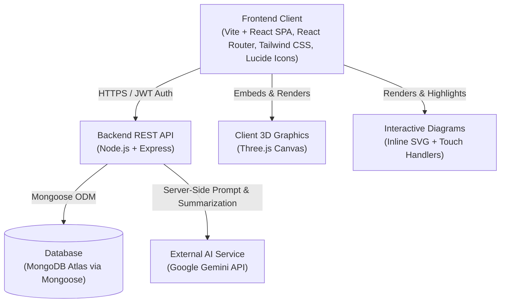

# Design.md: Architecture, Pages, Data Models & API Specifications

**Project:** STEM Education Platform  
**Target:** SIH 2026 / School STEM for Underserved & Rural Communities  
**Source of Truth:** [PRD.md](file:///c:/Users/kusha/OneDrive/Desktop/Stem-Edu/Stem-Edu/PRD.md) and [Tasks.md](file:///c:/Users/kusha/OneDrive/Desktop/Stem-Edu/Stem-Edu/Tasks.md)  
**Status:** Phase 0 Architecture Blueprint  

---

## 1. System Architecture & Tech Stack



- **Frontend:** React (Vite), React Router v6, Pure CSS / Tailwind CSS, Lucide React icons, Three.js (for 3D simulation).
- **Backend:** Node.js, Express.js (REST API, hand-written JWT auth & scoring middleware).
- **Database:** MongoDB Atlas (Mongoose ODM).
- **AI / LLM:** Google Gemini API (`@google/genai` or standard REST endpoint) strictly called from backend routes with server-side caching.
- **Security:** Passwords hashed with `bcryptjs`, JWT stored in `localStorage` or `HttpOnly` cookies, zero secrets on frontend, sanitized inputs.

---

## 2. Pages & UI Specifications (Part 1A)

Every page is mobile-first (optimized for 375px+ screens), accessible (WCAG AA, non-color status indicators), and low-bandwidth friendly.

### 2.1 Public Pages

#### 1. Landing Page (`/`)
- **Route:** `/`
- **Access:** Public (Unauthenticated)
- **Purpose:** Introduce the platform's core mission: free, board-aligned STEM education, bilingual support, interactive experiments, and AI revision.
- **Components & Layout:**
  - **Top Navigation Bar:** Brand logo ("STEM Edu"), language selector toggle (`EN | HI`), "Login" and "Sign Up" CTA buttons.
  - **Hero Section:** Clear headline ("Master STEM in Your Language with Hands-on Labs & AI"), subhead, primary CTA ("Start Learning Free" $\rightarrow$ `/signup`), and secondary CTA ("Explore Demo Chapters" $\rightarrow$ `/subjects`).
  - **Feature Showcase Cards:** 4 pillar cards highlighting Lessons, MCQ Practice, Interactive Diagrams, and 3D Virtual Labs.
  - **Subject Preview Grid:** Cards for Physics, Chemistry, Biology, and Mathematics with sample chapter labels.
  - **Footer:** Accessibility links, open-source attribution, and language selector.
- **Responsive Behavior:** 1 column on mobile (<640px), 2 columns on tablet, 3-4 columns on desktop.

#### 2. Sign Up Page (`/signup`)
- **Route:** `/signup`
- **Access:** Public
- **Purpose:** Onboard new students or teachers in under 2 minutes.
- **Components & Layout:**
  - Card container with brand header.
  - Form Fields:
    - `name` (text input, min 2 chars)
    - `email` or `phone` (identifier text input)
    - `password` (password input with show/hide toggle, min 6 chars)
    - `board` (segmented control / pill selector: `CBSE` default, extensible)
    - `classLevel` (pill selector: `Class 10` default)
    - `language` (segmented selector: `English` / `हिंदी`)
  - Primary Submit Button: "Create Account".
  - Navigation Link: "Already have an account? Log In" (`/login`).
- **States:** Loading spinner on submission, inline validation errors for missing fields or existing accounts.

#### 3. Log In Page (`/login`)
- **Route:** `/login`
- **Access:** Public
- **Purpose:** Authenticate existing users and redirect them to their designated dashboard.
- **Components & Layout:**
  - Form Fields: `identifier` (email or phone) and `password`.
  - Primary Action Button: "Log In".
  - Navigation Link: "New to STEM Edu? Create an account" (`/signup`).
- **States:** Invalid credentials alert banner, disabled button during authentication check.

---

### 2.2 Student Pages (Authenticated)

All student pages include the persistent **Mobile Bottom Navigation Bar**:
- **Home** (`/dashboard`)
- **Learn** (`/subjects`)
- **Practice** (`/results`)
- **Profile** (`/profile`)

#### 4. Student Dashboard (`/dashboard`)
- **Route:** `/dashboard`
- **Access:** Authenticated (`role: student`)
- **Purpose:** Serve as the student's central launchpad showing ongoing progress, bookmarks, and quick actions.
- **Components & Layout:**
  - **Greeting Header:** "Welcome back, {Name}!" with class badge (`Class 10 - CBSE`) and current language indicator.
  - **"Continue Learning" Card:** Dynamic hero card pointing to the `lastAccessedLessonId` with a visual progress bar and "Resume Lesson" button.
  - **Subject Progress Grid:** 4 cards (Physics, Chemistry, Biology, Mathematics) showing chapter progress percentages.
  - **Quick Lab & Diagram Featurette:** Direct shortcut to the Simple Pendulum virtual lab and featured interactive diagram.
  - **Recent Test Scores:** List of last 3 test attempts with chapter title, date, and score pill.
- **States:** Skeleton loaders for dynamic cards; empty state prompting the student to start their first lesson.

#### 5. Subjects List Page (`/subjects`)
- **Route:** `/subjects`
- **Access:** Authenticated
- **Purpose:** Display all STEM subjects available for the student's board and class.
- **Components & Layout:**
  - Header: "Explore Subjects".
  - Cards Grid:
    - **Physics:** Electricity & Light (Theme: Blue `#2563EB`)
    - **Chemistry:** Chemical Reactions & Acids (Theme: Violet `#7C3AED`)
    - **Biology:** Life Processes (Theme: Green `#16A34A`)
    - **Mathematics:** Real Numbers & Polynomials (Theme: Amber `#CA8A04`)
  - Each card displays subject icon, title (bilingual), total chapters count, and completed percentage.
  - Clicking a card navigates to `/subjects/:subjectId/chapters/:chapterId`.

#### 6. Chapter View Page (`/subjects/:subjectId/chapters/:chapterId`)
- **Route:** `/subjects/:subjectId/chapters/:chapterId`
- **Access:** Authenticated
- **Purpose:** Present the structured lesson hierarchy and test entry point for a single chapter.
- **Components & Layout:**
  - **Chapter Header:** Chapter number, English & Hindi titles, overview description, and circular progress indicator.
  - **Action Banner:** "Test Your Knowledge" CTA button $\rightarrow$ `/practice/:chapterId`.
  - **Lesson Accordion / List:** Sequential list of lessons with:
    - Lesson number & title.
    - Status icon: Completed (green checkmark), In Progress (blue dot), or Unread.
    - Badges for embedded diagrams or labs.
    - Tap navigates to `/lessons/:lessonId`.
  - **Linked Interactive Resources:** Direct links to chapter diagrams and virtual labs.

#### 7. Lesson Reader Page (`/lessons/:lessonId`)
- **Route:** `/lessons/:lessonId`
- **Access:** Authenticated
- **Purpose:** Distraction-free, readable content viewer with embedded visuals and AI summary.
- **Components & Layout:**
  - **Top Navigation Bar:** Back button, chapter breadcrumb, and "AI Summarise" button with sparkles icon.
  - **Content Body:** Renders structured blocks:
    - Text blocks (clean typography, 18px body font for easy mobile reading).
    - Formula callouts with KaTeX math rendering.
    - Important notes callouts (highlighted background).
    - Embedded Interactive Diagram component (if linked).
    - Direct link banner to Virtual Lab (if lesson includes lab).
  - **Footer Action Bar:**
    - "Mark as Complete" button (updates DB progress, triggers success animation).
    - "Next Lesson" / "Take Chapter Test" button.
  - **AI Summary Bottom Sheet / Drawer:**
    - Triggered by "AI Summarise".
    - Displays 3-5 concise bullet points in the student's chosen language (English or Hindi).
    - Cached result returns in <100ms; fresh Gemini calls show a friendly progress bar.
    - Includes "Retry" button on network timeout.

#### 8. MCQ Practice Test Page (`/practice/:chapterId`)
- **Route:** `/practice/:chapterId`
- **Access:** Authenticated
- **Purpose:** Test student understanding with server-scored multiple choice questions.
- **Components & Layout:**
  - **Header:** Chapter title, current question counter (`Question 3 of 10`), progress bar.
  - **Question Card:**
    - Question text in student's preferred language (with optional language toggle).
    - 4 large-tap option cards (radio selection).
    - Never shows correct/incorrect indicators during the test.
  - **Bottom Navigation:**
    - "Previous" button.
    - "Next" / "Submit Test" button.
  - **Exit Confirmation Modal:** Prevents accidental navigation without submitting.
  - **Empty State:** Friendly banner if no questions exist for this chapter yet.

#### 9. Test Result Screen (`/results/:resultId`)
- **Route:** `/results/:resultId`
- **Access:** Authenticated
- **Purpose:** Provide immediate, encouraging feedback with detailed explanations.
- **Components & Layout:**
  - **Score Summary Card:** Large score display (e.g., `8 / 10 - 80%`), performance badge ("Excellent Understanding" / "Needs Revision"), and time spent.
  - **Question-by-Question Review List:**
    - Question statement.
    - Student's selected option with icon and label:
      - Correct: Green checkmark icon + `[Your Answer: Correct]`.
      - Incorrect: Red cross icon + `[Your Answer: Incorrect]`.
    - Correct answer highlighted with green border + checkmark icon + `[Correct Answer]`.
    - Clear, step-by-step pedagogical explanation text.
  - **Action Buttons:** "Retake Test", "Back to Chapter", "Continue Learning".

#### 10. Results History Page (`/results`)
- **Route:** `/results`
- **Access:** Authenticated
- **Purpose:** Allow students to review their historical test performance over time.
- **Components & Layout:**
  - Filter by Subject (All, Physics, Chemistry, Biology, Math).
  - Chronological card list of past attempts: Chapter title, score percentage pill, date taken, and "Review Solutions" link.
  - Empty state with "Start your first test" action.

#### 11. Virtual Lab Page (`/labs/:labId`)
- **Route:** `/labs/:labId`
- **Access:** Authenticated
- **Purpose:** Provide an interactive hands-on 3D physics experiment replacing missing physical equipment.
- **Components & Layout:**
  - **3D Canvas Viewport:** Three.js scene showing the Simple Pendulum oscillating in real time.
  - **Simulation Controls Drawer:**
    - String Length slider ($L$: 0.2m to 2.0m).
    - Bob Mass slider ($m$: 0.05kg to 1.0kg).
    - Gravity dropdown ($g$: Earth $9.8 \text{ m/s}^2$, Moon $1.62 \text{ m/s}^2$, Jupiter $24.79 \text{ m/s}^2$).
    - Release Angle slider ($\theta_0$: $5^\circ$ to $30^\circ$).
    - Controls: "Start", "Pause", "Reset", and "Slow Motion (0.5x)".
  - **Live Readout Box:** Computed Period ($T = 2\pi\sqrt{L/g}$), stopwatch counter, and oscillation cycle count.
  - **Lab Procedure & Instructions Tab:** Guided 3-step experimental method.
  - **Observation Quiz Section:** 3-5 deduction questions at the conclusion of the experiment.
  - **Fallback Mode:** 2D canvas animation for low-end devices without WebGL.

#### 12. Student Profile & Settings Page (`/profile`)
- **Route:** `/profile`
- **Access:** Authenticated
- **Purpose:** Manage student preferences and display overall progress summary.
- **Components & Layout:**
  - Profile header: Name, Email/Phone, Role badge.
  - Preferences editor:
    - Board selection (CBSE).
    - Class selection (Class 10).
    - Preferred language switch (English / Hindi).
  - Lifetime Stats: Total lessons completed, tests taken, overall average score.
  - "Log Out" action button with confirmation dialog.

---

### 2.3 Admin Pages (Role-Gated: `role: admin`)

#### 13. Admin Dashboard (`/admin`)
- **Route:** `/admin`
- **Access:** Admin only (`role: admin`)
- **Purpose:** Overview metrics and shortcuts for content management.
- **Components:** Metric counters (Total Users, Subjects, Chapters, Lessons, MCQs), recent activity log, quick navigation links.

#### 14. Admin Content Manager (`/admin/content`)
- **Route:** `/admin/content`
- **Access:** Admin only
- **Purpose:** CRUD interface for Subjects, Chapters, and Lessons.
- **Components:** Tabbed navigation, data tables with edit/delete modals, multi-block lesson editor supporting bilingual inputs (English & Hindi) and diagram bindings.

#### 15. Admin Question Bank (`/admin/questions`)
- **Route:** `/admin/questions`
- **Access:** Admin only
- **Purpose:** Author and manage MCQs with chapter assignment, 4 options, correct answer index, and detailed bilingual explanations.

#### 16. Admin Diagrams & Labs (`/admin/diagrams`, `/admin/labs`)
- **Route:** `/admin/diagrams`, `/admin/labs`
- **Access:** Admin only
- **Purpose:** Manage SVG diagram elements and lab observation questions.

#### 17. Admin User Manager (`/admin/users`)
- **Route:** `/admin/users`
- **Access:** Admin only
- **Purpose:** View registered students and assign administrative roles.

---

## 3. MongoDB Data Models & Schemas (Part 1B)

Every field has a specified type, validation constraints, and a clear one-line purpose.

### 3.1 `User` Collection

```javascript
// Model: User
{
  _id: ObjectId,              // Unique identifier for the user account.
  name: String,               // Full display name of the student or administrator (required, trimmed).
  email: String,              // Unique email address used for login and notifications (optional if phone is provided, lowercase, index).
  phone: String,              // Unique mobile phone number for rural/SMS-based authentication (optional if email is provided, index).
  passwordHash: String,       // Bcrypt-hashed password string (required, never exposed in JSON responses).
  role: String,               // Role-based access control: 'student' | 'admin' | 'teacher' (default: 'student').
  classLevel: Number,         // Academic grade level (e.g., 10) for filtering relevant curriculum content (default: 10).
  board: String,              // Education board code (e.g., 'CBSE') determining syllabus mapping (default: 'CBSE').
  language: String,           // Preferred UI and content language: 'en' | 'hi' (default: 'en').
  createdAt: Date,            // Timestamp of account creation (auto-managed by Mongoose timestamps).
  updatedAt: Date             // Timestamp of last profile update (auto-managed by Mongoose timestamps).
}
```

### 3.2 `Subject` Collection

```javascript
// Model: Subject
{
  _id: ObjectId,              // Unique identifier for the subject entity.
  name: String,               // Standard English name of the subject (e.g., 'Physics', 'Mathematics') (required).
  nameHindi: String,          // Hindi translation of the subject name (e.g., 'भौतिक विज्ञान', 'गणित') (required).
  code: String,               // URL-friendly unique slug identifier (e.g., 'physics', 'math') (unique, index).
  description: String,        // One-line summary of the subject domain and scope.
  descriptionHindi: String,   // Hindi summary of the subject domain and scope.
  icon: String,               // Icon identifier string (e.g., 'Atom', 'Flask', 'Dna', 'Calculator') for frontend rendering.
  color: String,              // Hex primary brand color code for cards and theme accents (e.g., '#2563EB').
  classLevel: Number,         // Target school grade standard (e.g., 10) (index).
  board: String,              // Target curriculum board (e.g., 'CBSE') (index).
  order: Number,              // Sorting index for displaying subjects in the user interface (default: 0).
  createdAt: Date,            // Timestamp when the subject was created.
  updatedAt: Date             // Timestamp when the subject was last modified.
}
```

### 3.3 `Chapter` Collection

```javascript
// Model: Chapter
{
  _id: ObjectId,              // Unique identifier for the chapter entity.
  subjectId: ObjectId,        // Foreign key referencing the parent Subject document (ref: 'Subject', required, index).
  chapterNumber: Number,      // Official textbook chapter sequence number (e.g., 12 for Electricity) (required).
  title: String,              // English title of the chapter (e.g., 'Electricity') (required).
  titleHindi: String,         // Hindi translated title of the chapter (e.g., 'विद्युत') (required).
  description: String,        // Brief synopsis of the chapter's conceptual syllabus.
  descriptionHindi: String,   // Hindi synopsis of the chapter's conceptual syllabus.
  board: String,              // Target education board (e.g., 'CBSE') (index).
  classLevel: Number,         // Target grade standard (e.g., 10) (index).
  order: Number,              // Display ordering index within the parent subject (default: 0).
  createdAt: Date,            // Timestamp when the chapter was created.
  updatedAt: Date             // Timestamp when the chapter was last modified.
}
```

### 3.4 `Lesson` Collection

```javascript
// Model: Lesson
{
  _id: ObjectId,              // Unique identifier for the individual lesson document.
  chapterId: ObjectId,        // Foreign key referencing the parent Chapter document (ref: 'Chapter', required, index).
  lessonNumber: Number,       // Sequence index of the lesson within its chapter (required).
  title: String,              // English title of the lesson (e.g., "Ohm's Law and Resistance") (required).
  titleHindi: String,         // Hindi title of the lesson (e.g., "ओम का नियम और प्रतिरोध") (required).
  contentBlocks: [{           // Ordered array of rich content elements forming the lesson body.
    type: String,             // Block format discriminator: 'text' | 'image' | 'formula' | 'callout' | 'diagram' (required).
    content: String,          // English body text or markdown string for the content block.
    contentHindi: String,     // Hindi translation of the block content.
    mediaUrl: String,         // Optional external or static asset URL for diagrams or photos.
    diagramId: ObjectId       // Optional reference to a linked Diagram document (ref: 'Diagram').
  }],
  diagramId: ObjectId,        // Optional primary interactive diagram linked to this lesson (ref: 'Diagram').
  labId: ObjectId,            // Optional virtual lab simulation linked to this lesson (ref: 'Lab').
  cachedSummary: {            // Key-value store of pre-generated Gemini AI summaries mapped by language code.
    en: String,               // Cached English bulleted summary text.
    hi: String                // Cached Hindi bulleted summary text.
  },
  order: Number,              // Order index for sequential progression through chapter lessons (default: 0).
  createdAt: Date,            // Timestamp when the lesson was created.
  updatedAt: Date             // Timestamp when the lesson was last modified.
}
```

### 3.5 `Question` Collection

```javascript
// Model: Question
{
  _id: ObjectId,              // Unique identifier for the MCQ question.
  chapterId: ObjectId,        // Foreign key referencing the tested Chapter (ref: 'Chapter', required, index).
  lessonId: ObjectId,         // Optional foreign key referencing a specific Lesson within the chapter (ref: 'Lesson').
  questionText: String,       // English statement of the question (required).
  questionTextHindi: String,  // Hindi translated statement of the question (required).
  options: [String],          // Array of exactly 4 multiple-choice options in English (required, length: 4).
  optionsHindi: [String],     // Array of exactly 4 multiple-choice options in Hindi (required, length: 4).
  correctOptionIndex: Number, // Zero-based index (0, 1, 2, or 3) indicating the correct option (never sent to client during test).
  explanation: String,        // Pedagogical step-by-step English solution explaining why the correct option is right (required).
  explanationHindi: String,   // Pedagogical step-by-step Hindi solution for the answer (required).
  difficulty: String,         // Difficulty classification: 'easy' | 'medium' | 'hard' (default: 'medium').
  createdAt: Date,            // Timestamp when the question was added.
  updatedAt: Date             // Timestamp when the question was last modified.
}
```

### 3.6 `TestResult` Collection

```javascript
// Model: TestResult
{
  _id: ObjectId,              // Unique identifier for the student test submission attempt.
  userId: ObjectId,           // Foreign key referencing the student who took the test (ref: 'User', required, index).
  chapterId: ObjectId,        // Foreign key referencing the chapter tested (ref: 'Chapter', required, index).
  totalQuestions: Number,     // Total count of questions in the test attempt (required).
  score: Number,              // Total count of correctly answered questions (required).
  percentage: Number,         // Calculated percentage score (0 to 100) for progress metrics (required).
  answers: [{                 // Itemized record of student answers for permanent historical review.
    questionId: ObjectId,     // Reference to the answered Question document (ref: 'Question', required).
    selectedOptionIndex: Number, // Student's chosen option index (0-3), or -1 if unanswered (required).
    isCorrect: Boolean,       // True if selected option matched the server's correctOptionIndex (required).
    correctOptionIndex: Number, // Stored correct index snapshot so review screen renders without extra queries (required).
    explanation: String       // Stored explanation snapshot in student's language for instant review (required).
  }],
  timeTakenSeconds: Number,   // Total duration in seconds spent by the student on the test session.
  createdAt: Date             // Submission timestamp (index, used for sorting newest attempts first).
}
```

### 3.7 `Progress` Collection

```javascript
// Model: Progress
{
  _id: ObjectId,              // Unique identifier for the student-chapter progress record.
  userId: ObjectId,           // Foreign key referencing the student (ref: 'User', required, index).
  chapterId: ObjectId,        // Foreign key referencing the Chapter being tracked (ref: 'Chapter', required, index).
  completedLessons: [ObjectId], // Array of unique Lesson IDs that the student has marked as completed (refs: 'Lesson').
  totalLessonsCount: Number,  // Total lessons in the chapter at last evaluation (used for percentage calculation).
  completionPercentage: Number, // Percentage of completed lessons in the chapter: (completed / total) * 100 (default: 0).
  lastAccessedLessonId: ObjectId, // Reference to the most recently read Lesson for bookmarking (ref: 'Lesson').
  lastAccessedAt: Date,       // Timestamp when the student last opened or interacted with this chapter.
  updatedAt: Date             // Timestamp when progress was last updated.
}
// Compound unique index: { userId: 1, chapterId: 1 } ensures one progress record per user per chapter.
```

### 3.8 `Diagram` Collection

```javascript
// Model: Diagram
{
  _id: ObjectId,              // Unique identifier for the interactive diagram asset.
  title: String,              // English name of the diagram (e.g., 'Simple Electric Circuit') (required).
  titleHindi: String,         // Hindi translated name of the diagram (e.g., 'सरल विद्युत परिपथ') (required).
  subjectId: ObjectId,        // Foreign key referencing the relevant Subject (ref: 'Subject', required).
  svgViewBox: String,         // Coordinate bounding box for responsive SVG scaling (e.g., '0 0 800 600') (required).
  elements: [{                // List of interactive, tappable SVG parts and hotspots.
    id: String,               // Unique anchor key for the element (e.g., 'battery', 'switch', 'bulb') (required).
    label: String,            // English title label for the component part (required).
    labelHindi: String,       // Hindi title label for the component part (required).
    shape: String,            // SVG primitive type: 'path' | 'circle' | 'rect' | 'polygon' (required).
    pathData: String,         // SVG path definition string 'd' (required if shape is 'path').
    attributes: Map,          // Dynamic SVG attributes (cx, cy, r, x, y, width, height, stroke, fill).
    explanation: String,      // English explanation displayed in the drawer when student taps this part (required).
    explanationHindi: String  // Hindi explanation displayed when tapped (required).
  }],
  createdAt: Date,            // Timestamp when the diagram was created.
  updatedAt: Date             // Timestamp when the diagram was last modified.
}
```

### 3.9 `Lab` Collection

```javascript
// Model: Lab
{
  _id: ObjectId,              // Unique identifier for the virtual lab experiment document.
  title: String,              // English title of the experiment (e.g., 'Simple Pendulum Experiment') (required).
  titleHindi: String,         // Hindi title of the experiment (e.g., 'सरल लोलक प्रयोग') (required).
  subjectId: ObjectId,        // Foreign key referencing the parent Subject (ref: 'Subject', required).
  experimentType: String,     // Simulation identifier mapped to frontend 3D renderer: 'simple_pendulum' (required).
  description: String,        // Theoretical summary of the physical phenomenon being investigated.
  descriptionHindi: String,   // Hindi theoretical summary of the experiment.
  instructions: [String],     // Sequential procedural steps guiding the student through the simulation.
  instructionsHindi: [String], // Hindi procedural steps for the simulation.
  variables: [{               // Student-controllable physical parameters.
    name: String,             // Identifier symbol: 'length' | 'mass' | 'gravity' | 'angle' (required).
    label: String,            // English UI slider label (e.g., 'String Length (L)') (required).
    labelHindi: String,       // Hindi UI slider label (e.g., 'डोरी की लंबाई (L)') (required).
    unit: String,             // Scientific unit symbol: 'm' | 'kg' | 'm/s²' | 'deg' (required).
    min: Number,              // Lower slider boundary (required).
    max: Number,              // Upper slider boundary (required).
    step: Number,             // Slider increment precision (required).
    defaultValue: Number      // Initial slider value on scene launch (required).
  }],
  observationQuestions: [{   // End-of-lab deduction quiz testing conceptual understanding.
    question: String,         // Question statement in English.
    questionHindi: String,    // Question statement in Hindi.
    options: [String],        // 4 multiple-choice options in English.
    optionsHindi: [String],   // 4 multiple-choice options in Hindi.
    correctIndex: Number,     // Zero-based index of the correct deduction.
    explanation: String       // Physics explanation for the observation.
  }],
  createdAt: Date,            // Timestamp when the lab was created.
  updatedAt: Date             // Timestamp when the lab was last modified.
}
```

---

## 4. API Routes Specification (Part 2)

All API endpoints are grouped logically. Protected routes require `Authorization: Bearer <jwt_token>` header.

### 4.1 System & Health

#### `GET /api/health`
- **Access:** Public
- **Purpose:** Server heartbeat and uptime monitoring.
- **Request:** None
- **Response:**
  - Status `200 OK`:
    ```json
    { "status": "ok", "timestamp": "2026-11-12T17:45:00.000Z" }
    ```

---

### 4.2 Authentication & Profile (`/api/auth`, `/api/me`)

#### `POST /api/auth/signup`
- **Access:** Public
- **Purpose:** Register a new user account with hashed password.
- **Request Body:**
  ```json
  {
    "name": "Aman Sharma",
    "email": "aman@example.com",
    "phone": "9876543210",
    "password": "securePassword123",
    "board": "CBSE",
    "classLevel": 10,
    "language": "hi"
  }
  ```
- **Responses:**
  - Status `201 Created`:
    ```json
    {
      "token": "eyJhbGciOiJIUzI1NiIsIn...",
      "user": {
        "id": "64a0f1...",
        "name": "Aman Sharma",
        "email": "aman@example.com",
        "role": "student",
        "classLevel": 10,
        "board": "CBSE",
        "language": "hi"
      }
    }
    ```
  - Status `400 Bad Request`: `{ "message": "Email or phone already registered" }`
  - Status `422 Unprocessable Entity`: `{ "message": "Validation error: password must be at least 6 characters" }`

#### `POST /api/auth/login`
- **Access:** Public
- **Purpose:** Authenticate user and issue signed JWT.
- **Request Body:**
  ```json
  {
    "identifier": "aman@example.com",
    "password": "securePassword123"
  }
  ```
- **Responses:**
  - Status `200 OK`: Returns JWT token and sanitized user profile object.
  - Status `401 Unauthorized`: `{ "message": "Invalid email/phone or password" }`

#### `GET /api/me`
- **Access:** Authenticated (`requireAuth`)
- **Purpose:** Fetch authenticated user's current profile and preferences.
- **Request:** None (uses JWT from `Authorization` header).
- **Responses:**
  - Status `200 OK`: `{ "user": { "id": "...", "name": "...", "role": "...", "classLevel": 10, "board": "CBSE", "language": "hi" } }`
  - Status `401 Unauthorized`: `{ "message": "Authentication token missing or invalid" }`

#### `PUT /api/me`
- **Access:** Authenticated (`requireAuth`)
- **Purpose:** Update user settings (board, class, preferred language, name).
- **Request Body:**
  ```json
  {
    "name": "Aman Sharma",
    "board": "CBSE",
    "classLevel": 10,
    "language": "en"
  }
  ```
- **Responses:**
  - Status `200 OK`: `{ "message": "Profile updated", "user": { ... } }`

---

### 4.3 Subjects & Chapters (`/api/subjects`, `/api/chapters`)

#### `GET /api/subjects`
- **Access:** Authenticated (`requireAuth`)
- **Purpose:** List subjects matching student's board and class level.
- **Query Params (Optional):** `?board=CBSE&class=10` (defaults to student's profile settings).
- **Response `200 OK`:**
  ```json
  [
    {
      "id": "sub_phy_10",
      "name": "Physics",
      "nameHindi": "भौतिक विज्ञान",
      "code": "physics",
      "icon": "Atom",
      "color": "#2563EB",
      "chaptersCount": 1
    }
  ]
  ```

#### `GET /api/subjects/:id/chapters`
- **Access:** Authenticated (`requireAuth`)
- **Purpose:** List all chapters for a given subject with user's progress percentage.
- **Response `200 OK`:**
  ```json
  [
    {
      "id": "chap_elec_12",
      "chapterNumber": 12,
      "title": "Electricity",
      "titleHindi": "विद्युत",
      "description": "Electric circuits, Ohm's law, resistance, and electrical energy.",
      "totalLessons": 4,
      "completionPercentage": 50
    }
  ]
  ```

#### `GET /api/chapters/:id`
- **Access:** Authenticated (`requireAuth`)
- **Purpose:** Fetch chapter metadata and its ordered lesson overview.
- **Response `200 OK`:** Returns chapter details with lessons summary and linked lab/diagram IDs.

---

### 4.4 Lessons & AI Summary (`/api/lessons`)

#### `GET /api/chapters/:id/lessons`
- **Access:** Authenticated (`requireAuth`)
- **Purpose:** Fetch all lessons within a chapter in sequence.
- **Response `200 OK`:** Array of lessons with titles, order, and completion status.

#### `GET /api/lessons/:id`
- **Access:** Authenticated (`requireAuth`)
- **Purpose:** Fetch full content blocks of a lesson for reading.
- **Response `200 OK`:**
  ```json
  {
    "id": "les_01",
    "chapterId": "chap_elec_12",
    "lessonNumber": 1,
    "title": "Electric Current and Potential Difference",
    "titleHindi": "विद्युत धारा और विभवांतर",
    "contentBlocks": [
      { "type": "text", "content": "An electric current is expressed by the amount of charge flowing...", "contentHindi": "विद्युत आवेश के प्रवाह की दर को विद्युत धारा कहते हैं..." }
    ],
    "diagramId": "diag_circuit_01",
    "labId": null,
    "isCompleted": true
  }
  ```

#### `POST /api/lessons/:id/summary`
- **Access:** Authenticated (`requireAuth`)
- **Purpose:** Request an AI-generated concise lesson summary in the user's language.
- **Behavior:** Checks `cachedSummary[language]` in MongoDB first; if missing, invokes Gemini API, saves result to cache, and returns summary.
- **Request Body (Optional):** `{ "language": "hi" }` (defaults to user profile language).
- **Responses:**
  - Status `200 OK`:
    ```json
    {
      "lessonId": "les_01",
      "language": "hi",
      "summary": "1. विद्युत आवेश के प्रवाह की दर को विद्युत धारा कहते हैं (I = Q/t)।\n2. धारा का मात्रक एम्पीयर (A) है...\n3. विभवांतर को वोल्ट (V) में मापा जाता है।",
      "isCached": true
    }
    ```
  - Status `503 Service Unavailable`: `{ "message": "AI service temporarily unavailable, please retry" }`

---

### 4.5 Progress Tracking (`/api/progress`)

#### `POST /api/lessons/:id/complete`
- **Access:** Authenticated (`requireAuth`)
- **Purpose:** Mark a lesson as completed by the student and recalculate chapter percentage.
- **Response `200 OK`:**
  ```json
  {
    "message": "Lesson marked complete",
    "chapterId": "chap_elec_12",
    "completedLessonsCount": 2,
    "totalLessonsCount": 4,
    "completionPercentage": 50
  }
  ```

#### `GET /api/progress`
- **Access:** Authenticated (`requireAuth`)
- **Purpose:** Get overall learning progress across all subjects and recent bookmarks for the dashboard.
- **Response `200 OK`:** Returns array of chapter progress records and `lastAccessedLesson`.

---

### 4.6 MCQ Practice & Scoring (`/api/practice`, `/api/results`)

#### `GET /api/chapters/:id/test`
- **Access:** Authenticated (`requireAuth`)
- **Purpose:** Fetch test questions for a chapter **without** exposing correct answers or explanations.
- **Security Guarantee:** `correctOptionIndex` and `explanation` are explicitly stripped from output.
- **Response `200 OK`:**
  ```json
  [
    {
      "id": "q_01",
      "questionText": "What is the SI unit of electric current?",
      "questionTextHindi": "विद्युत धारा का SI मात्रक क्या है?",
      "options": ["Volt", "Ampere", "Ohm", "Watt"],
      "optionsHindi": ["वोल्ट", "एम्पीयर", "ओम", "वाट"]
    }
  ]
  ```

#### `POST /api/chapters/:id/test/submit`
- **Access:** Authenticated (`requireAuth`)
- **Purpose:** Hand-written scoring route that validates answers on the server, creates a `TestResult` record, and returns full explanations.
- **Request Body:**
  ```json
  {
    "answers": [
      { "questionId": "q_01", "selectedOptionIndex": 1 },
      { "questionId": "q_02", "selectedOptionIndex": 2 }
    ],
    "timeTakenSeconds": 145
  }
  ```
- **Response `200 OK`:**
  ```json
  {
    "resultId": "res_98765",
    "score": 10,
    "totalQuestions": 10,
    "percentage": 100,
    "feedback": "Outstanding! You have mastered this chapter.",
    "answers": [
      {
        "questionId": "q_01",
        "selectedOptionIndex": 1,
        "correctOptionIndex": 1,
        "isCorrect": true,
        "explanation": "Ampere (A) is the SI unit of electric current, defined as one coulomb of charge per second."
      }
    ]
  }
  ```

#### `GET /api/results`
- **Access:** Authenticated (`requireAuth`)
- **Purpose:** List all historical test attempts for the authenticated student, sorted newest first.
- **Response `200 OK`:** Array of test result summaries (`resultId`, `chapterTitle`, `score`, `percentage`, `createdAt`).

#### `GET /api/results/:id`
- **Access:** Authenticated (`requireAuth`)
- **Purpose:** Fetch detailed breakdown of a specific past test result with explanations.
- **Response `200 OK`:** Full `TestResult` document.

---

### 4.7 Interactive Diagrams & Virtual Labs (`/api/diagrams`, `/api/labs`)

#### `GET /api/diagrams/:id`
- **Access:** Authenticated (`requireAuth`)
- **Purpose:** Fetch SVG coordinates, element definitions, and bilingual explanations for an interactive diagram.
- **Response `200 OK`:** Full `Diagram` document.

#### `GET /api/labs/:id`
- **Access:** Authenticated (`requireAuth`)
- **Purpose:** Fetch virtual lab parameters, instructions, variable bounds, and observation quiz questions.
- **Response `200 OK`:** Full `Lab` document.

#### `POST /api/labs/:id/submit`
- **Access:** Authenticated (`requireAuth`)
- **Purpose:** Score the end-of-lab observation quiz and record lab completion.
- **Request Body:** `{ "answers": [0, 2, 1] }`
- **Response `200 OK`:** `{ "score": 3, "total": 3, "passed": true, "explanations": [...] }`

---

### 4.8 Admin Content Management (`/api/admin/*`)

All admin routes require `requireAuth` + `requireAdmin` role verification.

| Method | Endpoint | Description |
|---|---|---|
| `POST` | `/api/admin/subjects` | Create a new subject |
| `PUT` | `/api/admin/subjects/:id` | Update an existing subject |
| `DELETE` | `/api/admin/subjects/:id` | Delete subject (checks for active student references) |
| `POST` | `/api/admin/chapters` | Create a new chapter |
| `PUT` | `/api/admin/chapters/:id` | Update a chapter |
| `DELETE` | `/api/admin/chapters/:id` | Delete a chapter safely |
| `POST` | `/api/admin/lessons` | Create a new lesson with content blocks |
| `PUT` | `/api/admin/lessons/:id` | Update lesson content blocks |
| `DELETE` | `/api/admin/lessons/:id` | Delete a lesson |
| `POST` | `/api/admin/questions` | Create an MCQ with correct answer index |
| `PUT` | `/api/admin/questions/:id` | Update question, options, or explanation |
| `DELETE` | `/api/admin/questions/:id` | Delete a question |
| `POST` | `/api/admin/diagrams` | Create or update an interactive SVG diagram |
| `POST` | `/api/admin/labs` | Create or update a virtual lab configuration |
| `GET` | `/api/admin/users` | List registered users with pagination & search |
| `PUT` | `/api/admin/users/:id/role`| Modify a user's role (`student` $\leftrightarrow$ `admin`) |

---

## 5. v1 Content Scope & Curricular Baseline (Part 3)

### 5.1 Curriculum Baseline
- **Educational Board:** **CBSE** (Central Board of Secondary Education / NCERT framework).
- **Target Grade:** **Class 10** (Crucial board examination year where foundational STEM decides stream selection in senior secondary).
- **Languages Supported for v1:**
  1. **English** (Standard medium of examination).
  2. **Hindi (हिंदी)** (Primary vernacular for rural and semi-urban outreach across North & Central India).

---

### 5.2 Four Selected Chapters (1 per Subject)

#### 1. Physics: Chapter 12 — *Electricity* (*विद्युत*)
- **Subject Code:** `physics`
- **Class:** 10 | **Board:** CBSE
- **Syllabus Coverage:**
  1. Lesson 1: Electric Current, Charge, and Simple Circuits ($I = Q/t$).
  2. Lesson 2: Electric Potential Difference ($V = W/Q$).
  3. Lesson 3: Ohm's Law, Resistance, and Factors on which Resistance Depends ($V = IR$, $\rho = RA/l$).
  4. Lesson 4: Resistors in Series and Parallel, Heating Effect ($H = I^2Rt$), and Electric Power ($P = VI$).
- **Interactive Diagram:** **Simple Electric Circuit with Voltmeter, Ammeter, Key & Rheostat** (tappable components with interactive current flow visualization).
- **Question Bank:** 12 board-pattern MCQs with step-by-step numerical explanations.

#### 2. Chemistry: Chapter 1 — *Chemical Reactions and Equations* (*रासायनिक अभिक्रियाएं एवं समीकरण*)
- **Subject Code:** `chemistry`
- **Class:** 10 | **Board:** CBSE
- **Syllabus Coverage:**
  1. Lesson 1: Chemical Equations and the Law of Conservation of Mass (Balancing Chemical Equations).
  2. Lesson 2: Types of Chemical Reactions: Combination and Decomposition Reactions.
  3. Lesson 3: Types of Chemical Reactions: Displacement and Double Displacement Reactions (Precipitation).
  4. Lesson 4: Oxidation and Reduction Reactions (Redox), Corrosion, and Rancidity.
- **Interactive Diagram:** **Visual Classification of Chemical Reaction Types & Particle Interaction Model**.
- **Question Bank:** 12 conceptual MCQs on identifying reaction types and oxidation states.

#### 3. Biology: Chapter 6 — *Life Processes* (*जैव प्रक्रम*)
- **Subject Code:** `biology`
- **Class:** 10 | **Board:** CBSE
- **Syllabus Coverage:**
  1. Lesson 1: What are Life Processes? Autotrophic Nutrition (Photosynthesis mechanism and stomata).
  2. Lesson 2: Heterotrophic Nutrition and Human Digestive System (Alimentary Canal).
  3. Lesson 3: Respiration in Humans and Plants (Aerobic vs. Anaerobic, ATP production).
  4. Lesson 4: Transportation (Human Heart Anatomy, Double Circulation) and Excretion (Nephron structure).
- **Interactive Diagram:** **Anatomy of the Human Heart & Double Circulation System** (clickable chambers, valves, and pulmonary/systemic paths).
- **Question Bank:** 12 MCQs covering enzyme functions, heart valves, and kidney filtration.

#### 4. Mathematics: Chapter 1 — *Real Numbers* (*वास्तविक संख्याएं*)
- **Subject Code:** `mathematics`
- **Class:** 10 | **Board:** CBSE
- **Syllabus Coverage:**
  1. Lesson 1: Review of Numbers and the Fundamental Theorem of Arithmetic.
  2. Lesson 2: Finding HCF and LCM using Prime Factorisation Method ($HCF \times LCM = a \times b$).
  3. Lesson 3: Revisiting Irrational Numbers (Contradiction proofs for $\sqrt{2}, \sqrt{3}, \sqrt{5}$).
  4. Lesson 4: Rational Numbers and their Terminating / Non-terminating Repeating Decimal Expansions.
- **Interactive Diagram:** **Interactive Prime Factorization & Venn Diagram for HCF / LCM Calculation**.
- **Question Bank:** 12 MCQs with step-by-step proofs and arithmetic calculations.

---

### 5.3 v1 Virtual Lab Experiment Specification (Simple Pendulum)

Per **Tasks.md Section 9.2**, the primary v1 virtual lab experiment is **The Simple Pendulum** (Physics).

#### 1. Scientific Principles & Theoretical Model
A simple pendulum consists of a point mass (bob) suspended from a fixed support by a massless, inextensible string of length $L$.
Under small angle approximations ($\theta \le 15^\circ$), the motion is simple harmonic motion (SHM) governed by:

$$T = 2\pi \sqrt{\frac{L}{g}}$$

Where:
- $T$ = Time period of one complete oscillation (seconds).
- $L$ = Length of the pendulum string (meters).
- $g$ = Acceleration due to gravity ($\text{m/s}^2$).

#### 2. Experimental Variables & Controls
- **Length ($L$):** Adjustable from $0.2\text{ m}$ to $2.0\text{ m}$ (Step: $0.05\text{ m}$, Default: $1.0\text{ m}$).
- **Bob Mass ($m$):** Adjustable from $0.05\text{ kg}$ to $1.0\text{ kg}$ (Step: $0.05\text{ kg}$, Default: $0.2\text{ kg}$).
- **Gravity Field ($g$):** Selectable preset gravity environments:
  - Earth: $g = 9.8\text{ m/s}^2$
  - Moon: $g = 1.62\text{ m/s}^2$
  - Jupiter: $g = 24.79\text{ m/s}^2$
- **Initial Amplitude Angle ($\theta_0$):** Slider from $5^\circ$ to $25^\circ$ (Step: $1^\circ$, Default: $10^\circ$).

#### 3. Expected Physical Results & Student Discoveries
1. **Length Dependence:** Increasing string length $L$ increases the oscillation period $T$ proportional to $\sqrt{L}$. (If $L$ quadruples from $0.25\text{ m}$ to $1.0\text{ m}$, period $T$ doubles).
2. **Mass Independence:** Changing the bob mass $m$ does **not** change the period $T$. (A $0.1\text{ kg}$ bob swings with the exact same period as a $1.0\text{ kg}$ bob).
3. **Gravity Dependence:** In lower gravity (Moon), the pendulum swings much slower ($T \approx 4.94\text{ s}$ for $1\text{ m}$ vs $2.006\text{ s}$ on Earth).

#### 4. End-of-Lab Observation Quiz
1. *If you double the length of a pendulum string, what happens to its time period?*
   - Options: `A) It doubles`, `B) It increases by a factor of 1.414 (√2)`, `C) It quadruples`, `D) It remains unchanged`
   - Correct: `B` | Explanation: $T \propto \sqrt{L}$, so multiplying $L$ by 2 multiplies $T$ by $\sqrt{2} \approx 1.414$.
2. *How does changing the mass of the bob from 50g to 500g affect the period of a pendulum?*
   - Options: `A) Period becomes 10 times longer`, `B) Period becomes 10 times shorter`, `C) Period remains completely unchanged`, `D) Period halves`
   - Correct: `C` | Explanation: The formula $T = 2\pi\sqrt{L/g}$ contains no mass variable $m$; period is independent of mass for small angles.
3. *On the Moon where gravity is 1/6th of Earth's gravity, the pendulum swings:*
   - Options: `A) Faster`, `B) Slower`, `C) At the same rate`, `D) Backwards`
   - Correct: `B` | Explanation: Since $g$ is in the denominator under the square root, smaller $g$ results in a longer time period $T$, meaning slower oscillations.


---

## 6. Phase 2 Architecture, Free-Tier Limits, New Tables & API Routes

### 6.1 Locked Design Decisions (P2-0.2)
- **AI Character Name:** **Saarthi** (Single AI persona serving as mentor, study planner, and 24/7 doubt solver).
- **Target Classes:** CBSE **Class 10 and Class 12** across Mathematics, Physics, Chemistry, Biology.
- **Languages:** English (`en`), Hindi (`hi`), and Marathi (`mr`).
- **Database & Vector Store:** **Supabase PostgreSQL** with `pgvector` (`vector(768)` matching Gemini `text-embedding-004`).
- **Video & Asset Hosting:** Cloudinary free tier, unlisted YouTube, or Supabase Storage.

### 6.2 Free-Tier Limits & Quota Protection (P2-0.4)
- **Google Gemini API Free Tier:**
  - 15 Requests Per Minute (RPM)
  - 1,500 Requests Per Day (RPD)
  - 1,000,000 Tokens Per Minute (TPM)
  - Mitigation: `aiRateLimiter` middleware (`express-rate-limit`) limits users to 30 requests per 15 minutes, with in-memory daily usage tracking.
- **Supabase Free Tier:**
  - Database Size: 500 MB (shared with vector embeddings)
  - File Storage: 1 GB
  - Monthly Active Users: 50,000
  - Egress Bandwidth: 2 GB / month
  - Auto-pausing: Inactive projects paused after 7 days; periodic health check prevents pause during development.

### 6.3 Phase 2 Database Tables (Supabase PostgreSQL)
1. `public.chunks`:
   - `id uuid primary key`
   - `content text not null`
   - `content_hash text unique not null`
   - `embedding vector(768)`
   - `embedding_model text`
   - `board text not null default 'CBSE'`
   - `class_level int`
   - `subject text`
   - `chapter text`
   - `page int`
   - `language text not null default 'en'`
   - `source text`
   - `type text check (type in ('textbook', 'notes', 'question', 'video'))`
   - `user_id uuid references auth.users(id) on delete cascade`
2. `public.chat_sessions`:
   - `id uuid primary key`
   - `user_id uuid not null references auth.users(id) on delete cascade`
   - `title text not null`
   - `mode text not null default 'doubt' check (mode in ('doubt', 'mentor'))`
   - `subject text`
   - `created_at timestamptz default now()`
3. `public.chat_messages`:
   - `id uuid primary key`
   - `session_id uuid not null references public.chat_sessions(id) on delete cascade`
   - `user_id uuid not null references auth.users(id) on delete cascade`
   - `role text not null check (role in ('user', 'assistant', 'system'))`
   - `content text not null`
   - `sources jsonb default '[]'::jsonb`
   - `created_at timestamptz default now()`
4. `public.memory_facts`:
   - `id uuid primary key`
   - `user_id uuid not null references auth.users(id) on delete cascade`
   - `type text not null check (type in ('weakness', 'strength', 'goal', 'preference'))`
   - `text text not null`
   - `subject text`
   - `importance int default 1`
   - `embedding vector(768)`
   - `created_at timestamptz default now()`
   - `last_used_at timestamptz default now()`

### 6.4 Phase 2 Navigation Routes & Pages
- `/mentor` - Saarthi interactive chat interface with doubt & mentor modes
- `/virtual-learning` - 3D visual interactive simulations gallery
- `/virtual-learning/:topic` - Specific 3D simulation canvas (Ray Optics, Conic Cone, etc.)
- `/labs` - 3D Virtual Science Labs catalogue
- `/labs/:id` - Interactive lab workbench with HUD & observation quiz
- `/videos` - AI video lectures and chapter recaps
- `/community` - Discord community link & live study channels
- `/notes/handwriting` - Text-to-handwriting canvas & handwritten notes OCR scanner
- `/offline` - Offline study center with synced notes and quizzes

### 6.5 Phase 2 REST API Routing
- `POST /api/mentor/sessions` - Create chat session
- `GET /api/mentor/sessions` - List student chat sessions
- `POST /api/mentor/sessions/:id/messages` - Send message and retrieve Saarthi RAG response
- `GET /api/mentor/memory` - View stored memory facts
- `DELETE /api/mentor/memory/:id` - Forget specific memory fact
- `POST /api/rag/query` - Vector similarity retrieval via `match_chunks`
- `POST /api/rag/ingest` - Admin document ingestion & vector embedding
