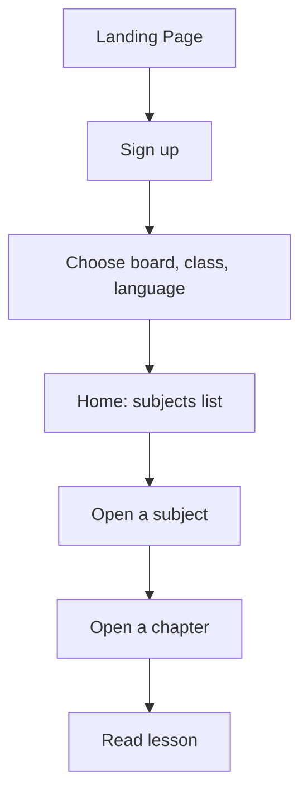
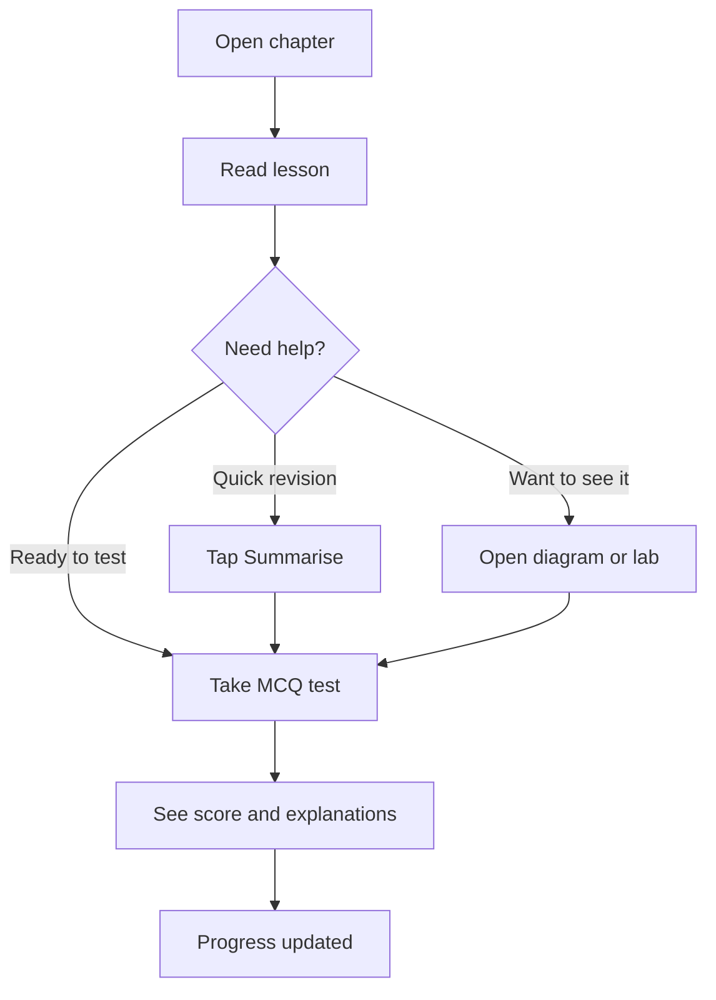
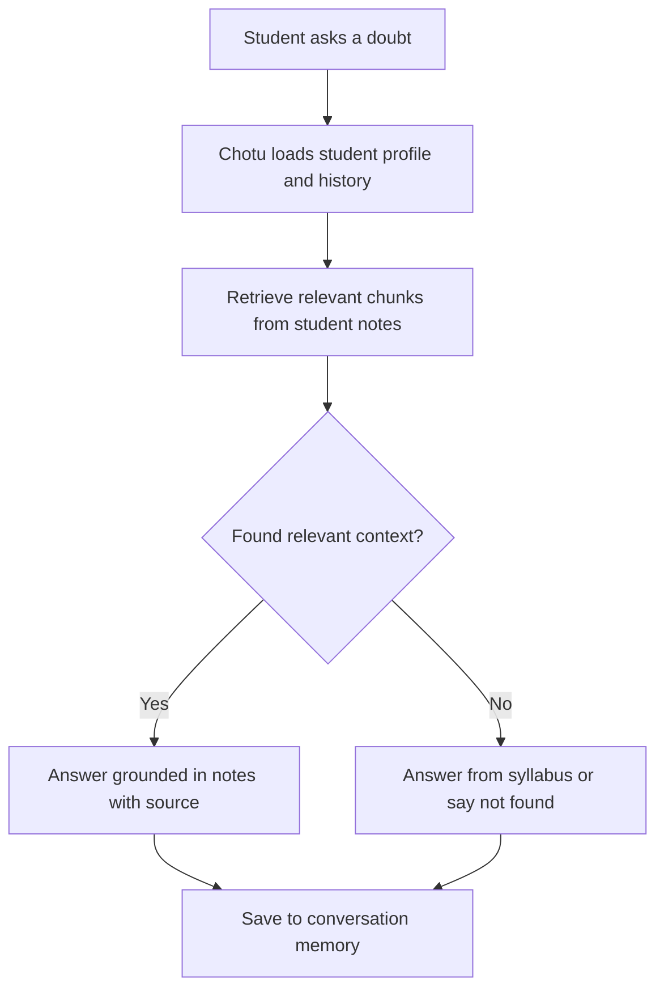
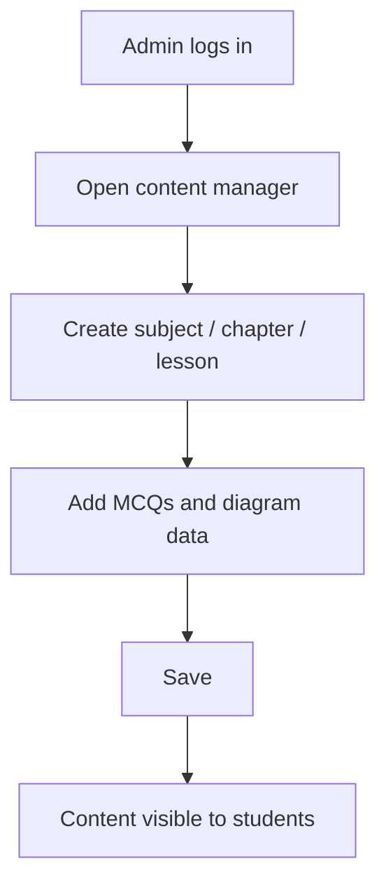

# PRD.md: STEM Education Platform (working title)

Source: SIH 2026 problem statement, **STEM Education**. Structure follows the QRaksha PRD.

## 1. Product Overview

**Product name:** STEM Education Platform (working title)

**One-line description:** A learning platform that gives school students, especially rural and underserved ones, STEM lessons in their own board and language, an AI mentor ("Chotu") that answers doubts 24/7 using their own study material, and virtual labs and interactive diagrams in place of real labs.

**Executive summary:** Many students in rural and underserved communities study Maths, Physics, Chemistry and Biology with few qualified teachers, no labs, content in a language they are not comfortable with, and nobody to ask a doubt after school hours. This platform tackles those four gaps together. Students learn from board-aligned lessons and notes, practise with MCQs, explore concepts through interactive diagrams and 3D virtual experiments, and ask doubts to Chotu, an AI mentor that remembers their level and answers from the student's own notes and textbooks (a user-based RAG pipeline). Parts of the app work offline for low-connectivity areas.

**Problem statement:** Students in rural and underserved communities lack (a) teachers who can explain STEM well, (b) lab access for experiments, (c) content in their board and language, (d) help outside school hours, and (e) reliable internet to use ordinary online platforms.

**Why the problem matters:** STEM understanding in school decides later access to higher education and careers. Practical subjects like Physics, Chemistry and Biology are taught from a textbook alone when no lab exists, so students memorise instead of understanding. Doubts that go unanswered pile up and compound.

**Target users (primary):** School students (to start, classes 10 to 12) in rural, semi-urban and underserved communities.

**Secondary users:**
- **Teachers**: upload notes and questions, see how students are doing (Stage 2).
- **Platform admin / content operator**: manage subjects, chapters, MCQs and labs.
- **Schools / NGOs** (post-MVP, SaaS): onboard many students and teachers under one organisation.

**Core value proposition:** "A teacher, a lab and a doubt-solver in every student's pocket, in their own language, even with weak internet."

**Product principles:**
1. **Learner first.** Simple screens, large tap targets, plain language, no jargon.
2. **Low bandwidth by default.** Light pages and content that can be cached and used offline.
3. **Grounded answers.** Chotu answers from the student's syllabus and notes and says so when it does not know, instead of guessing.
4. **Learn by doing.** Every concept should offer something to interact with (an MCQ, a diagram or an experiment), not only text.
5. **Build small, then expand.** v1 uses the MERN stack plus simple APIs. Advanced features (RAG, 3D, offline) come in later phases once the basics work.
6. **Core logic is hand-written.** Auth, scoring, API routes and data models are written by hand so every choice can be explained.

**Key assumptions** (confirm or change these):
- Target classes 10 to 12 first; board: CBSE first; languages: English plus one regional language for the MVP.
- "Chotu" is **one** AI character that acts as both mentor and doubt solver.
- "Human handwriting / notes" means students can photograph handwritten notes and the app reads them (OCR) so they can be summarised and used in RAG. (If you meant notes shown in a handwriting style, this feature becomes much smaller.)
- Summaries use the Gemini API on its free tier.
- RAG, Chotu and the doubt solver are Phase 2 (February), after the MERN basics are done.
- Content for the MVP is seeded by the admin (a small set of chapters), not crowd-sourced.

### New technology (not yet learned)

Each item is new. When its turn comes, learn it step by step before building on it.

| Area | New tech |
|---|---|
| LLM calls (summary) | Gemini API, prompt design |
| Interactive diagrams | SVG / canvas interaction |
| 3D virtual labs | Three.js |
| RAG | Embeddings, vector database, chunking, retrieval |
| Chotu memory | Storing and retrieving conversation context |
| Handwriting notes | OCR |
| Offline mode | PWA, service workers, IndexedDB |
| AI video | AI video-generation tools |
| Sign language | Computer vision / ML (research first) |
| SaaS | Multi-tenancy, payments |

## 2. Goals

### MVP Goals

- A student can sign up and choose board, class and language in under 2 minutes.
- A student can open a subject, chapter and lesson and read the notes.
- A student can take a chapter MCQ test and see score and explanations immediately.
- A student can get an AI summary of a lesson in under 10 seconds.
- A student can open at least one interactive diagram and run at least one virtual lab experiment.
- An admin can add and edit subjects, chapters, lessons and MCQs without touching the code.
- A demo set exists: at least 1 chapter in each of the 4 subjects, with lessons and 10+ MCQs per chapter.

### Non-Goals (MVP)

- No user-based RAG pipeline, Chotu mentor, or 24/7 doubt solver (Phase 2).
- No handwriting/OCR notes (Phase 2).
- No full multi-board or multi-language support beyond the single board and language chosen for the MVP.
- No full 3D labs for every experiment (only one experiment in v1).
- No offline mode, native mobile app, Discord community, AI-generated video, sign language support or SaaS billing.
- No teacher dashboard or school/NGO management (Stage 2).

## 3. User Personas

### Persona 1: Rural School Student (primary)

- **Role:** Class 8 to 10 student in a village or small town.
- **Goals:** Understand lessons, practise for exams, get doubts cleared.
- **Pain points:** No good teacher for STEM, no lab, content mostly in English, patchy internet, shared or low-end phone.
- **Technical sophistication:** Low to moderate. Comfortable with a phone, YouTube and WhatsApp.
- **Typical workflow:** Opens the app after school, reads a chapter, takes an MCQ test, opens a diagram or experiment, and (Phase 2) asks Chotu a doubt.
- **Main reason for using the product:** Learn and revise without needing a teacher or a lab.
- **Important permissions:** Own profile, lessons, MCQs and results; summaries; (Phase 2) upload own notes and chat with Chotu.

### Persona 2: Student from an Underserved Community

- **Role:** Same as Persona 1, with extra barriers (language, cost, unreliable device or data).
- **Goals:** Same as Persona 1, without paying for tuition or high data usage.
- **Pain points:** Cannot afford coaching, content not in their mother tongue, limited data.
- **Typical workflow:** Short sessions on a low-end phone; relies on cached or offline content when available (Phase 3).
- **Important permissions:** Same as Persona 1.

### Persona 3: Teacher (Stage 2)

- **Role:** School teacher in a rural or semi-urban school.
- **Goals:** Share notes and question sets, see which students are struggling.
- **Pain points:** Large classes, little time, no tools for tracking individual progress.
- **Important permissions:** Upload content, view student results for their own class.

### Persona 4: Platform Admin / Content Operator

- **Role:** Project team member managing content.
- **Goals:** Seed and manage subjects, chapters, MCQs, diagrams and lab experiments; keep content accurate.
- **Technical sophistication:** High.
- **Important permissions:** Create, edit and delete all content; view usage stats; manage users.

## 4. Core Features

### MVP (Phase 1: MERN + simple APIs)

**Feature: Authentication and Student Profile**

- Purpose: Let each student have their own account and see content for their board, class and language.
- User value: Personalised content and saved progress.
- User story: As a student, I want to sign up and choose my class and language so I only see what I need.
- Functional requirements: Sign up and login with email or phone and password; JWT-based sessions; profile fields for name, class, board and language; roles (student, admin).
- Acceptance criteria: A new student completes sign-up and profile setup in under 2 minutes; protected routes reject unauthenticated requests; passwords are stored hashed, never in plain text.
- Edge cases: Duplicate email or phone shows a clear error; invalid or expired token redirects to login; changing class or language updates the content shown.
- Dependencies: Database, auth middleware (hand-written).
- Classification: MVP.

**Feature: Lessons and Notes**

- Purpose: Deliver the core learning content.
- User value: Board-aligned, chapter-wise lessons in a simple reading view.
- User story: As a student, I want to open a chapter and read clear notes so I can learn without a teacher.
- Functional requirements: Content hierarchy of subject, chapter, topic and lesson; lessons support headings, text, images and embedded interactive elements; content filtered by the student's board, class and language; mark a lesson as completed.
- Acceptance criteria: Every demo chapter opens and renders on a phone-sized screen; completed lessons are remembered; progress per chapter is shown.
- Edge cases: Content not available for the chosen language shows a fallback with a clear message; very long lessons are split into sections.
- Dependencies: Content database, admin content tools.
- Classification: MVP.

**Feature: MCQ Practice**

- Purpose: Let students test understanding and get instant feedback.
- User value: Practice with explanations for every answer.
- User story: As a student, I want to take a chapter test and see where I went wrong.
- Functional requirements: Chapter-wise question sets; one question at a time or a full list; scoring on the server; explanation shown after each answer or at the end; result history per student.
- Acceptance criteria: A test of 10 questions can be completed and scored; correct answers are never sent to the client before submission; past results are viewable.
- Edge cases: Closing the app mid-test saves progress or restarts cleanly; a chapter with no questions shows an empty state, not an error.
- Dependencies: Question bank, scoring logic (hand-written).
- Classification: MVP.

**Feature: AI Summary (Gemini)**

- Purpose: Give a quick, simple summary of a lesson or note.
- User value: Fast revision before a test.
- User story: As a student, I want a short summary of a lesson so I can revise quickly.
- Functional requirements: "Summarise" button on each lesson; backend calls the Gemini API with the lesson text and a summary prompt; result shown in the student's chosen language; summaries cached per lesson and language to save API calls.
- Acceptance criteria: A summary returns within 10 seconds for a typical lesson; the API key is never exposed to the frontend; a cached summary is returned instantly the second time.
- Edge cases: Gemini timeout or rate limit shows a retry message, not a blank screen; if the lesson is too long, it is split or trimmed before sending.
- Dependencies: Gemini API key, backend route. **New tech: LLM API calls.**
- Classification: MVP.

**Feature: Interactive Diagrams**

- Purpose: Make concepts visual and explorable.
- User value: Tap parts of a diagram (a plant cell, a circuit, the periodic table) to see names and explanations.
- User story: As a student, I want to tap a diagram and learn each part so I understand it, not just memorise it.
- Functional requirements: Diagrams drawn as SVG with clickable labelled regions; a side panel or tooltip with the explanation; at least one diagram each for Biology, Chemistry and Physics.
- Acceptance criteria: Each demo diagram works by touch on a phone; every labelled part shows its explanation; diagrams load fast on a slow connection.
- Edge cases: Very small screens use a zoom or pan gesture; missing explanation text falls back to the part name.
- Dependencies: Diagram data (JSON). **New tech: SVG / canvas interaction.**
- Classification: MVP.

**Feature: Virtual Lab (one experiment)**

- Purpose: Replace the missing real lab with a hands-on simulation.
- User value: Run an experiment, change variables and see results.
- User story: As a student, I want to try an experiment myself so I understand what really happens.
- Functional requirements: One 3D or 2D experiment in v1 (for example, a simple pendulum or circuit in Physics); controls for the key variables; step-by-step instructions; a short "what you observed" quiz at the end.
- Acceptance criteria: The experiment runs smoothly on a mid-range phone; changing a variable changes the outcome correctly; the end-of-lab questions are scored like MCQs.
- Edge cases: A device without WebGL support falls back to a 2D version or a clear message.
- Dependencies: Three.js. **New tech: 3D in the browser.** Full labs for all three sciences are Phase 3.
- Classification: MVP.

**Feature: Admin Content Management and Demo Seeding**

- Purpose: Let the team add and edit content without code changes.
- User value: Content stays accurate and grows quickly.
- User story: As an admin, I want to add a chapter and MCQs from a form so students get new content.
- Functional requirements: Admin-only pages to create, edit and delete subjects, chapters, lessons, MCQs and diagram data; a seed script that loads the demo content (1 chapter per subject).
- Acceptance criteria: Only admins can access these pages; a new chapter appears for students immediately after saving; the seed script can be re-run safely.
- Edge cases: Deleting a chapter that has student progress asks for confirmation and handles the progress data safely.
- Dependencies: Auth roles.
- Classification: MVP.

### Post-MVP (Phase 2: RAG / LLM, planned for February)

**Feature: User-Based RAG Pipeline**
- A student uploads their own notes or textbook (PDF or text); the content is split into chunks, embedded and stored; answers and summaries are grounded in that material.
- Acceptance: A question about an uploaded document is answered from that document and cites the part it came from; an unrelated question is answered as "not found in your notes".
- Dependencies: Embeddings, vector database. **New tech: RAG.** Study Arindam200/awesome-ai-apps for RAG, agent and MCP examples before building (mostly Python, so check how to adapt the ideas).

**Feature: Chotu, the AI Mentor**
- A persona with a friendly, encouraging style; stores the student's level, weak topics and past conversations; suggests what to study next.
- Dependencies: RAG pipeline, conversation storage. **New tech: LLM context storing.**

**Feature: 24/7 AI Doubt Solver**
- The student asks a doubt at any time; Chotu answers using the student's class, board, language and uploaded notes as context.
- Acceptance: Answers arrive within a few seconds; answers stay within the syllabus; unsafe or off-topic questions are politely declined.

**Feature: Handwriting / Notes (OCR)**
- The student photographs handwritten notes; OCR turns them into text that can be summarised and added to the RAG store. **New tech: OCR.**

**Feature: Multi-Board and Multi-Language Support**
- More boards (State boards, ICSE) and more regional languages; interface and content in the chosen language.

**Feature: Teacher Dashboard**
- Teachers upload notes and question sets and see class progress.

### Future / Experimental (Phase 3 and beyond)

- **Full 3D virtual labs** for Physics, Chemistry and Biology experiments.
- **Offline mode:** lectures, questions and notes available without internet. **New tech: PWA, service workers, IndexedDB.**
- **Community:** a Discord server or in-app community for students.
- **Pre-generated AI video lessons:** short explainer videos made ahead of time. **New tech: AI video tools.**
- **Sign language support** for students who are speech or hearing impaired. **New tech: heavy ML; research first.**
- **Mobile app** (Android): PWA first, then native only if needed.
- **SaaS model:** schools and NGOs subscribe, with multi-tenant data and payments. **New tech.**
- **Role-play learning (Chotu as a "Udemy-style" teacher):** interactive lesson sessions led by Chotu. Needs more definition.
- **Gamification:** points, streaks and badges to keep students motivated.

## 5. Core User Flows

### First-time student onboarding flow



### Learning loop (primary, recurring)



### Doubt solving flow (Phase 2)



### Admin content flow



### Returning-user / settings flow

Student logs in and lands on the dashboard: continue where they left off, progress per subject, recent test scores. Settings: change class, board or language; view test history; log out.

### Failure / error flow (shared)

Any failed external call (for example Gemini) shows a clear, friendly message and a retry button. The app never shows a blank screen, never invents an answer, and logs the error on the server with a request ID.

## 6. UI/UX Specification

### Design Language

- **Overall visual style:** Friendly and clear, with large readable text and simple layouts, built for phones first.
- **Brand personality:** Encouraging and trustworthy, like a good teacher. Chotu can have a simple friendly avatar in Phase 2.
- **Density:** Low density. One main task per screen, large tap targets.
- **Border radius:** Medium to large rounding (12px) on cards and buttons.
- **Cards:** Subjects, chapters and results are cards with an icon, title and progress.
- **Buttons:** One primary action per screen (Continue, Take test, Summarise).
- **Forms:** Single column, short steps.
- **Navigation:** Bottom tab bar on mobile (Home / Learn / Practice / Profile); Chotu tab added in Phase 2.
- **Typography:** System sans-serif stack (light on data); large body text, supports regional-language scripts.
- **Animation:** Minimal; small feedback on correct or wrong answers; respect reduced motion.
- **Performance:** Optimise images, lazy-load heavy parts (3D), keep the first load small.

### Color System

| Token | Light | Dark | Usage |
|---|---|---|---|
| Primary | `#2563EB` | `#60A5FA` | Main actions, links |
| Secondary | `#7C3AED` | `#A78BFA` | Accents, Chotu |
| Background | `#F8FAFC` | `#0B1220` | App background |
| Surface | `#FFFFFF` | `#111827` | Cards |
| Text | `#0F172A` | `#F1F5F9` | Body text |
| Muted text | `#64748B` | `#94A3B8` | Secondary text |
| Success | `#16A34A` | `#22C55E` | Correct answers, completed |
| Warning | `#CA8A04` | `#EAB308` | Needs revision |
| Error | `#DC2626` | `#EF4444` | Wrong answers, errors |

Dark mode follows the system setting.

### Responsive Design

- **Mobile (primary):** Single column, bottom tab navigation, breakpoint below 640px.
- **Tablet:** 640 to 1024px, same layout with wider margins; lessons and diagrams can sit side by side.
- **Desktop:** Above 1024px, content centred with a max width; the admin pages get a sidebar layout and data tables.
- **Component stacking:** Lesson text and interactive elements stack vertically on mobile.

### UX States (per feature)

- **Loading:** Skeleton cards for lists; a short status label for summaries ("Making your summary...").
- **Empty:** Clear message and next step (for example "No tests taken yet, try one now").
- **Success:** Positive, encouraging feedback after a test or a completed chapter.
- **Error:** Friendly message with retry; wrong answers are learning moments, not errors.
- **Offline / weak network:** A banner explains what needs internet (summary, AI); in Phase 3, downloaded content keeps working.
- **Unsupported device:** If WebGL is missing, show the 2D fallback for labs.

### Accessibility

- All content readable by screen readers; images and diagrams have text alternatives.
- Answers are never shown by colour alone; always with an icon and text.
- Minimum 4.5:1 contrast for text in both colour modes.
- Form fields have labels and clear inline errors.
- Text size adjustable; regional-language fonts render correctly.
- Sign language support is planned for Phase 3.

## 7. Information Architecture

**Public routes:**
- `/`: landing page
- `/login`, `/signup`

**Student routes (authenticated):**
- `/dashboard`: progress and continue learning
- `/subjects`: Maths, Physics, Chemistry, Biology
- `/subjects/:subjectId/chapters/:chapterId`: chapter page with lessons
- `/lessons/:lessonId`: lesson with Summarise, diagram and lab links
- `/practice/:chapterId`: MCQ test
- `/results`: past test results
- `/labs/:labId`: virtual lab
- `/profile`: class, board, language
- (Phase 2) `/chotu`: AI mentor and doubt solver; `/notes`: upload notes

**Admin routes (role-gated):**
- `/admin/content`: manage subjects, chapters, lessons
- `/admin/questions`: manage MCQs
- `/admin/diagrams`, `/admin/labs`: manage interactive content
- `/admin/users`: view users

**Modal / drawer behaviour:** The summary opens in a bottom sheet on mobile; test results open as a full-screen page.

**URL structure:** Resource-based (`/lessons/:id`), with query strings only for filtering and pagination on admin lists.

**Repository layout:**
```
project-name/
  frontend/    (React)
  backend/     (Node + Express + MongoDB)
  PRD.md
  Design.md
  Tasks.md
```

## 8. MVP Acceptance Criteria

The MVP is complete when all of the following are true:

1. A new student can sign up, choose board, class and language, and reach the home screen without help.
2. A student can read at least one full chapter in each of the four subjects.
3. A student can take a 10-question MCQ test, get a score and see explanations; correct answers are never exposed before submission.
4. The Summarise button returns a summary for any seeded lesson within 10 seconds, and a cached summary returns instantly.
5. At least one interactive diagram works on a phone for each of Biology, Chemistry and Physics.
6. At least one virtual lab experiment runs on a mid-range phone, and its end-of-lab questions are scored.
7. An admin can add a new chapter with MCQs from the admin pages and students see it immediately.
8. Unauthenticated users cannot access student or admin routes; non-admins cannot access admin routes.
9. API keys (Gemini) exist only on the backend and are never present in frontend code or network responses.
10. Every external call failure shows a friendly error with retry, and no screen is ever left blank.
11. The code is split into separate `frontend/` and `backend/` folders, and the core logic (auth, scoring, routes) is hand-written and explainable.

## 9. Open Questions

1. Is "Human handwriting / notes" OCR of the student's handwritten notes, or notes displayed in a handwriting style?
2. Is "Chotu" one character for both mentor and doubt solver?
3. Which classes, board and regional language come first?
4. Should a basic RAG version be included in v1, or stay in February?
5. Which single experiment should be the v1 virtual lab?

## 10. Next Files

- `Design.md`: pages, data models, API routes
- `Tasks.md`: ordered build tasks

For free external data (for example science or periodic-table APIs), check public-apis/public-apis before building your own.


---

## 10. Phase 2 Specifications: Intelligence, Immersion & Reach

### 10.1 Scope & Curriculum Expansion
- **Target Classes:** CBSE Class 10 and Class 12.
- **Subjects:** Mathematics, Physics, Chemistry, Biology.
- **Multilingual Support:** English (`en`), Hindi (`hi`), and Regional Language (Marathi `mr`).

### 10.2 Phase 2 Feature Pillars
1. **Saarthi AI Mentor & Doubt Solver:**
   - 24/7 doubt resolution grounded in NCERT & CBSE syllabus.
   - Long-term memory (`memory_facts`) across student sessions.
   - Socratic guidance for homework questions rather than direct answer dumps.
2. **CBSE & Personal Notes RAG Pipeline:**
   - Vector embeddings using Google Gemini `text-embedding-004` (768 dimensions).
   - Vector store in Supabase PostgreSQL via `pgvector` extension and HNSW cosine index.
   - Exact citation of textbook chapter and page numbers.
   - Strict student notes isolation enforced at both API and Postgres Row Level Security (RLS) layers.
3. **Virtual Learning & 3D Interactive Labs:**
   - High-fidelity Three.js 3D virtual experiments with small-angle SHM, ray optics, and conic cone slicing.
   - Observation quizzes and simulation parameter recording.
4. **AI Chapter Videos & Community:**
   - Video lecture previews with bilingual subtitles and progress tracking.
   - Discord community hub for peer discussions and doubt sharing.
5. **Offline PWA Learning:**
   - Service worker caching for questions, lessons, and student notes.
   - Local IndexedDB storage with auto-sync when back online.
