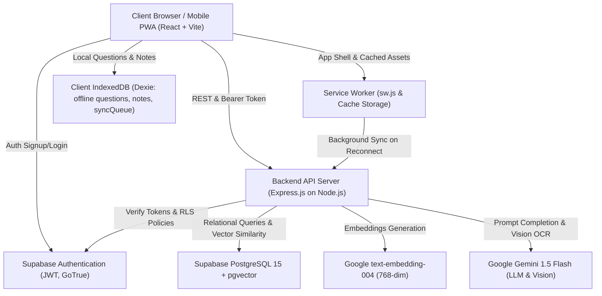
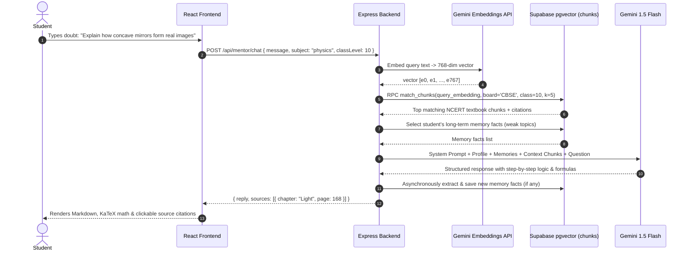
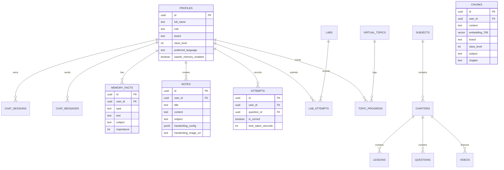

# 🏛️ System Architecture & Data Flow (Phase 2)

This document provides a comprehensive technical overview of the STEM Education Platform's architecture, including the RAG pipeline, Saarthi memory loop, Supabase PostgreSQL data schemas, and PWA offline synchronization.

---

## 1. High-Level Architecture Overview

---

## 2. CBSE RAG (Retrieval-Augmented Generation) Pipeline

---

## 3. Database Schema Entity-Relationship Diagram

---

## 4. PWA Offline-First & Sync Architecture

1. **Pre-caching:**
   - App shell (Vite bundles, CSS, Google Fonts, SVG diagram definitions) is precached during Service Worker install.
2. **Offline Data Storage:**
   - Dexie.js (IndexedDB) maintains stores for `questions`, `lessons`, `notes`, and `syncQueue`.
   - Students can download any chapter for 100% offline access.
3. **Offline Diagnostic Engine:**
   - The same scoring algorithm executes client-side during offline MCQ tests, evaluating correct answers and negative marking (-0.25).
4. **Idempotent Background Sync:**
   - When network connectivity is restored (`window.addEventListener('online')`), the Service Worker triggers `syncQueue` processing, replaying test attempts and newly authored notes to Supabase via upsert idempotency keys.
