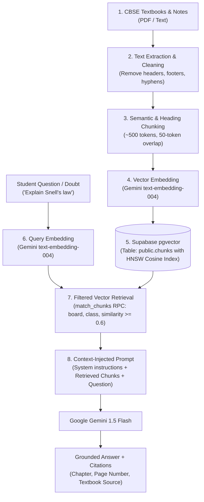

# CBSE-based Retrieval Augmented Generation (RAG) Architecture & Viva Guide

**Project:** STEM Education Platform (Phase 2, Task P2-2.1)  
**Target:** CBSE Class 10 & 12 (Physics, Chemistry, Biology, Mathematics)  
**Database & Vector Store:** Supabase PostgreSQL with `pgvector`  
**Embedding Model:** Google Gemini `text-embedding-004` (768 dimensions)  

---

## 1. What is RAG and Why Not Just Prompt the LLM?

**Retrieval-Augmented Generation (RAG)** is an AI system architecture that dynamically searches an authoritative external knowledge base (in our case, official NCERT/CBSE textbooks and student-uploaded study notes) to retrieve relevant text excerpts, and injects those excerpts into the LLM prompt as context before generating an answer.

### Why standard LLM prompting fails for CBSE education:
1. **Hallucination Risk:** Standard LLMs invent plausible-sounding but incorrect equations, scientific values, or historical facts.
2. **Lack of Syllabus Grounding:** An LLM might explain physics using advanced university quantum mechanics rather than standard CBSE Class 10 definitions required by board examiners to award marks.
3. **No Verifiable Citations:** Students cannot tell which page or chapter an answer came from, preventing cross-checking in their textbooks.
4. **No Private Student Context:** An LLM has no access to a student's handwritten lecture notes or past study mistakes unless dynamically injected.

---

## 2. The 8-Step RAG Pipeline

---

## 3. Five Common Viva Questions & Model Answers

### Q1: What is chunking, and why not embed the entire textbook chapter as a single vector?
**Answer:** Embedding models have token context limits, and more importantly, embedding an entire 30-page chapter averages out all the nuanced concepts into a single dilute vector representation. When a student asks a specific question (e.g., *"What is the SI unit of electric potential?"*), vector cosine similarity would be diluted. By chunking into 400–600 token blocks with 50-token overlap, each chunk represents a distinct, coherent concept with high semantic density.

### Q2: Why did you choose HNSW index over IVFFlat in pgvector?
**Answer:** 
- **IVFFlat (Inverted File Flat)** partitions vectors into lists and requires regular retraining as the dataset grows; it trades retrieval recall for indexing speed.
- **HNSW (Hierarchical Navigable Small World)** builds a multi-layer graph where nearest neighbor search executes in logarithmic time $O(\log N)$. It provides significantly higher recall (>95%) and superior query throughput under concurrent user doubt requests without needing index rebuilds.

### Q3: Why use Cosine Similarity (`vector_cosine_ops`) instead of Euclidean ($L_2$) distance?
**Answer:** Cosine similarity measures the angle between two embedding vectors regardless of their length:
$$\text{similarity} = \frac{\mathbf{u} \cdot \mathbf{v}}{\|\mathbf{u}\| \|\mathbf{v}\|}$$
In semantic embeddings, two texts of different lengths discussing the same scientific principle point in the same direction in 768-dimensional space. Euclidean distance would penalize length differences, whereas Cosine similarity isolates semantic direction.

### Q4: How does your RAG pipeline guarantee privacy when a student uploads their own notes?
**Answer:** Our database enforces privacy at two complementary layers:
1. **Database Schema & RLS:** In `public.chunks`, CBSE textbook chunks have `user_id = null` (shared publicly), while student note chunks store `user_id = auth.uid()`. PostgreSQL Row Level Security (RLS) ensures that unauthenticated clients or other students can never read or query another student's private chunks.
2. **Retrieval RPC Function (`match_chunks`):** The query filter strictly enforces `(c.user_id is null or c.user_id = p_user_id)`. Student B's UUID is never matched against Student A's queries.

### Q5: What is metadata filtering, and should it occur before or after vector similarity?
**Answer:** Metadata filtering narrows the candidate vectors by structured columns (`board = 'CBSE'`, `class_level = 10`, `subject = 'physics'`). In `pgvector` with HNSW, our SQL function performs **pre-filtering** using compound B-Tree indexes on `(board, class_level, subject, language)`. Pre-filtering eliminates irrelevant classes and boards before computing vector distance, ensuring a Class 10 student never retrieves Class 12 derivations.

